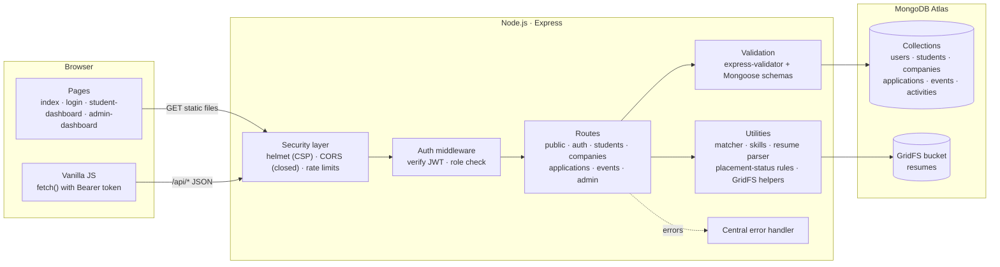
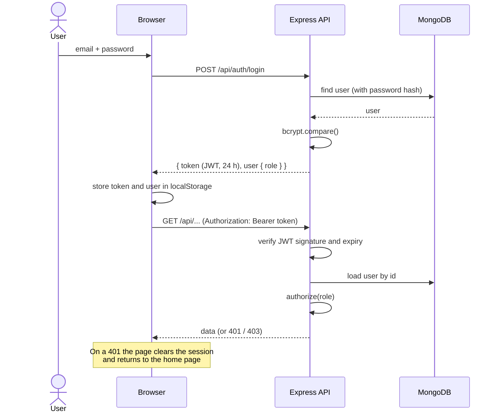
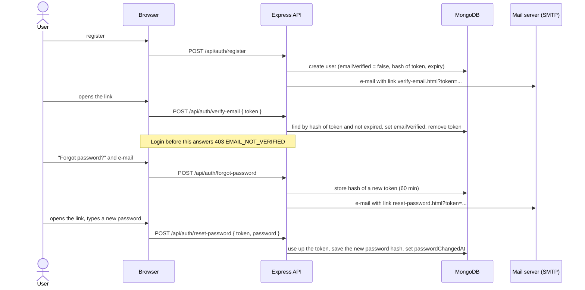
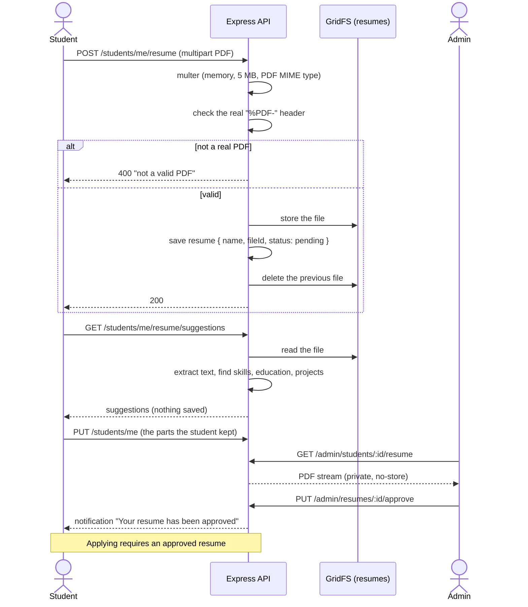
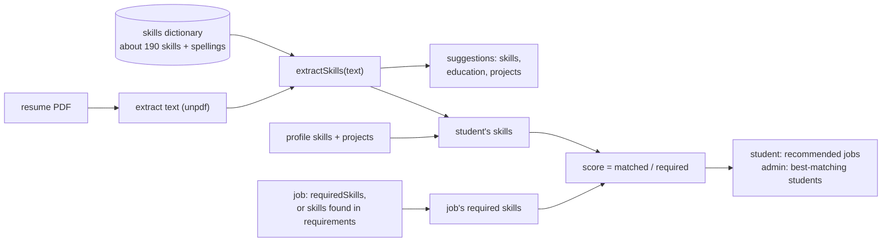
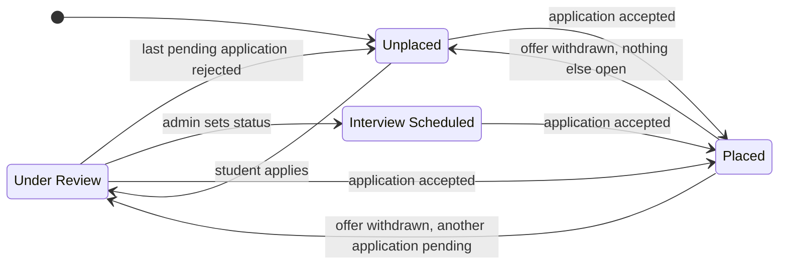

# Architecture

## 1. System overview

A three-tier web application served from a **single Node.js process**. Express serves the static frontend pages and the JSON API, and talks to MongoDB. Resume PDFs are stored in the same database (GridFS), so there is nothing else to run or back up.

**Why one origin?** Serving the frontend from Express means no CORS set-up, a single command to start, and a strict Content-Security-Policy (`connect-src 'self'`).

## 2. Request lifecycle

1. `helmet` adds the security headers, including the Content-Security-Policy.
2. CORS is off unless `CLIENT_ORIGIN` is set. JSON bodies are limited to 100 kB.
3. **Static files** (`/`, `/login.html`, `/css/*`, `/js/*`) are served by `express.static`.
4. **API calls** (`/api/*`) pass the rate limiters, then reach their route. Protected routes run `protect` (verifies the JWT and loads the user) and, where needed, `authorize('admin' | 'student')`.
5. Input is checked by `express-validator` on the auth and profile routes and by the Mongoose schemas everywhere.
6. Any error goes to `next(err)` and the **central error handler** turns it into a short 4xx or 5xx response. Unknown API paths get a JSON 404, unknown pages the branded `404.html`.

On startup the server connects to MongoDB first and exits with a clear message if that fails. `SIGINT` and `SIGTERM` close the HTTP server and the database connection before exiting.

## 3. Authentication and authorization

- **Roles:** `student` and `admin`. Public registration can only create students; admin accounts are created from the command line with `npm run create-admin` (`createAdmin.js`), with no built-in admin credentials anywhere.
- **Login pages:** the "Admin login" button (`login.html?admin=true`) admits only admins, the normal login only students. The server still checks the role on every route, so this is a convenience, not the security boundary.
- **Token:** a JWT holding the user id, signed with `JWT_SECRET`, valid for `JWT_EXPIRE` (24 h by default), kept in `localStorage`. The trade-off is described in the README.
- **Several tabs:** the session is shared by all tabs of a browser. When one tab logs in or out, the others reload (the `storage` event), so a stale tab can never keep acting as the previous user.

### E-mail verification and password reset

- **Tokens:** 32 random bytes in the link; only their SHA-256 hash is stored, so a copy of the database cannot be turned into working links. Each works once and expires.
- **No account enumeration:** forgot-password and resend-verification give the same answer whether or not the e-mail is registered, and send the mail in the background so the response time is the same.
- **Flood control:** one link per account per minute, and 30 e-mail requests per hour per address (`server.js`).
- **A reset signs everyone out:** `passwordChangedAt` is compared with the `iat` of every login token in `protect`.
- **A reset also verifies the e-mail,** because the link only reaches the owner of the inbox. This is also what lets the real owner take over an address that someone else registered without verifying it.
- **Mail transport:** `utils/mailer.js` sends through SMTP (Gmail by default). With no SMTP settings, outside production, it prints the message to the console instead.

## 4. Resume workflow

- The file is held in memory (never on disk) until it has passed the checks, so a rejected upload leaves nothing behind. If saving the metadata fails after the file was stored, the new file is deleted again.
- Resumes have **no public URL**. A student downloads their own through `/students/me/resume/file`, an admin any through `/admin/students/:id/resume`. The browser opens them from a temporary blob URL.
- The student's resume status is `pending` after every upload, then `approved` or `rejected` by the placement cell.

## 5. Job matching and resume scan

Everything here is deterministic code, with no external service.

- The dictionary ([`backend/data/skills.js`](../backend/data/skills.js)) maps spellings to one name (`nodejs`, `node.js` and `node` are all *Node.js*). Ambiguous names such as C, R or Go only count as a separate item in a Skills section.
- [`backend/utils/matcher.js`](../backend/utils/matcher.js) holds the pure functions that score a student against a job. [`backend/utils/resumeParser.js`](../backend/utils/resumeParser.js) reads the PDF (at most 10 pages, 8 seconds) and splits it into sections by heading.
- A job with no recognisable skills cannot be scored. It stays in the normal list and is left out of the recommendations.

## 6. Placement-status state machine

A student's `status` reflects their progress. The rules are in [`backend/utils/placementStatus.js`](../backend/utils/placementStatus.js) and covered by unit tests.

- Applying only moves an **Unplaced** student to *Under Review*. It never downgrades *Interview Scheduled* or *Placed*.
- Rejecting one application does not unplace a student who was accepted elsewhere.
- *Interview Scheduled* is set by an admin and is never overridden by application decisions, except by becoming *Placed*.
- The timeline records real status changes only. The reason for each decision also reaches the student as a notification.

## 7. Application rules

The server checks all of these when a student applies:

| Rule | Response |
|---|---|
| The company exists and is `active` | 404 or 400 |
| The company is open to the student's course | 403 |
| A resume is uploaded | 400 |
| The resume is `approved` (pending and rejected get different messages) | 400 |
| The profile has skills | 400 |
| The student has not applied to this company before (unique index) | 400 |

## 8. Frontend structure

There is no build step and no framework. Every page is plain HTML with a small script.

| File | Responsibility |
|---|---|
| `js/utils.js` | Shared helpers: `esc()` (escapes text for HTML), date helpers, `withLoading()` and `guarded()` (spinner and error toast around a task), `showLoadError()`, `initSidebar()`, `openProtectedPdf()` |
| `js/dashboard.js` | Shared by both dashboards: login check (`requireRole`), `apiFetch()`, toasts, sidebar navigation with URL hash, option lists from `/public/meta`, multi-tab session sync |
| `js/home.js` | Landing page: navigation, real statistics from `/public/stats` |
| `js/auth-common.js` | Helpers shared by the login-style pages: `post()` (JSON request with the server's error message), alerts, button spinner, show/hide password |
| `js/login.js` | Login and registration forms, the "Forgot password?" link and "Resend verification email" |
| `js/forgot-password.js`, `js/reset-password.js`, `js/verify-email.js` | The three single-card pages the e-mails link to. The reset and verify pages read `?token=` from the link and remove it from the address bar |
| `js/student-dashboard.js` | Dashboard, companies, profile, resume (upload and scan), status timeline, calendar, notifications |
| `js/admin-dashboard.js` | Dashboard (charts), companies and applications, students, resumes, calendar |

Conventions used in the page scripts:

- One `state` object per page holds the data; `render…()` functions turn it into HTML.
- Every user- or admin-entered value goes through `esc()` before it enters a template string.
- Buttons carry `data-action` attributes and one delegated click listener dispatches them, so the pages need no inline scripts or `onclick` attributes and the CSP can forbid them.
- Sections are `hidden` attribute toggles driven by the URL hash (`#companies`), so a refresh or a shared link stays on the same section.
- The layout is a fixed sidebar on desktop and a top bar with a slide-in menu below 993 px.
