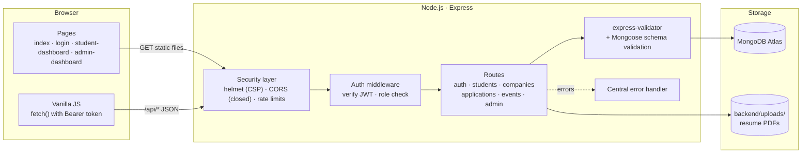
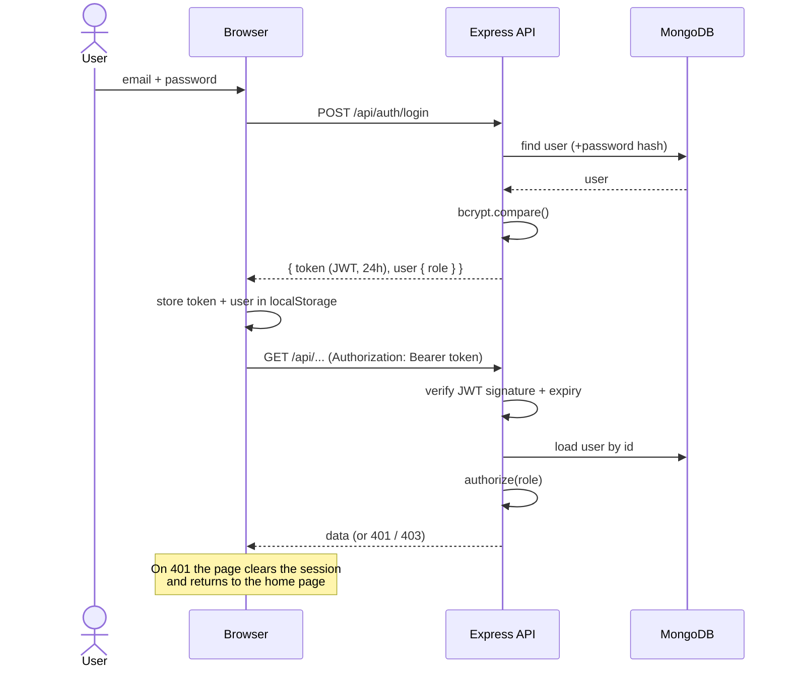
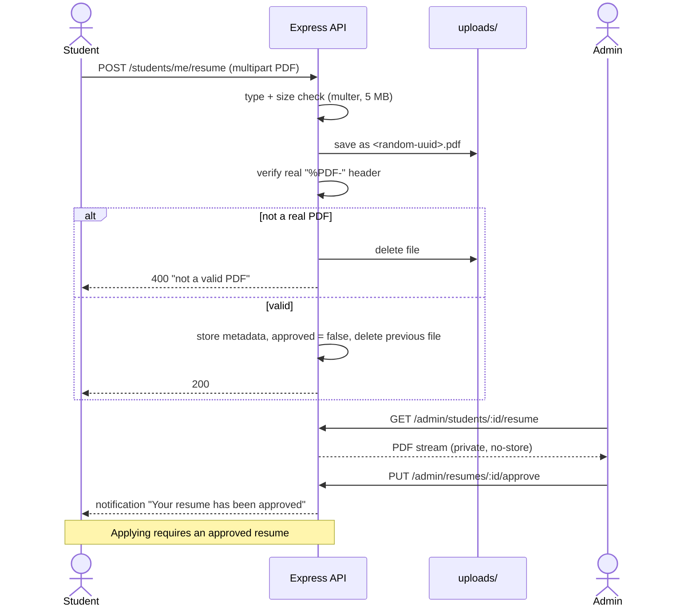
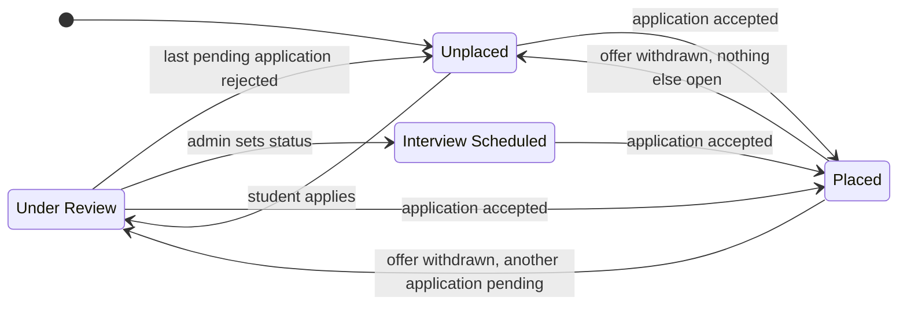

# Architecture

## 1. System overview

The app is a classic three-tier web application served from a **single Node.js process**: Express serves the static frontend pages *and* the JSON API, and talks to MongoDB.

**Why one origin?** Serving the frontend from Express means no CORS configuration is needed, the app starts with a single command, and the Content-Security-Policy can be strict (`connect-src 'self'`).

## 2. Request lifecycle

1. **Static files** (`/`, `/login.html`, `/css/*`, `/js/*`) are served by `express.static`.
2. **API calls** (`/api/*`) pass through, in order: `helmet` → CORS (disabled unless `CLIENT_ORIGIN` is set) → JSON body parsing (100 kB limit) → rate limiters → route.
3. Protected routes run `protect` (verifies the JWT and loads the user) and, where needed, `authorize('admin' | 'student')`.
4. Input is validated (`express-validator` on auth routes, Mongoose schemas everywhere).
5. Any error is passed to `next(err)` and mapped by the **central error handler** to a clean 4xx/5xx response. Unknown API paths return a JSON 404; unknown pages return the branded `404.html`.

## 3. Authentication & authorization

- **Roles**: `student` and `admin`. Public registration can only create students; the admin account is created by the seed script.
- **Login page modes**: the "Admin Login" link (`login.html?admin=true`) only accepts admins; the normal login only accepts students. The server still enforces roles on every route, so this is a convenience, not the security boundary.
- **Token**: JWT containing the user id, signed with `JWT_SECRET`, expiring after `JWT_EXPIRE` (default 24 h). It is stored in `localStorage` (see the trade-off noted in the README).

## 4. Resume workflow

Resumes are **never** exposed through a public URL; both the student and the admin download them through authenticated routes, and the browser opens them from a temporary blob URL.

## 5. Placement-status state machine

A student's `status` reflects their progress. The rules live in [`backend/utils/placementStatus.js`](../backend/utils/placementStatus.js) and are covered by unit tests.

Key rules:
- Applying only moves an **Unplaced** student to *Under Review*; it never downgrades *Interview Scheduled* or *Placed*.
- Rejecting one application does **not** unplace a student who has been accepted elsewhere.
- *Interview Scheduled* is set manually by an admin and is never overridden by application decisions (other than becoming *Placed*).
- The timeline records only real status changes; the reason for each decision also appears as a notification.

## 6. Application rules

A student can apply to a company only if **all** of these hold (checked on the server):

| Rule | Error |
|---|---|
| Company exists and is `active` | 404 / 400 |
| The company is open to the student's branch | 403 |
| The student has uploaded a resume | 400 |
| The resume is **approved** by an admin | 400 |
| The profile has skills filled in | 400 |
| They have not applied to this company before (unique index) | 400 |

## 7. Frontend structure

| File | Responsibility |
|---|---|
| `js/utils.js` | Shared helpers: `esc()` (XSS-safe text), `openProtectedPdf()`, `initSidebar()`, `withLoading()`, `guarded()`, `showLoadError()` |
| `js/home.js` | Landing page: navbar, scroll effects, counters |
| `js/login.js` | Login / registration, role-specific login modes |
| `js/student-dashboard.js` | Student sections: dashboard, companies, profile, resume, status, calendar, notifications |
| `js/admin-dashboard.js` | Admin sections: dashboard (charts), companies, students, resumes, calendar |

Pages are plain HTML; dynamic content is rendered with template strings where **every** user- or admin-entered value goes through `esc()`. Layout uses a fixed sidebar on desktop and a top bar with a slide-in drawer below 993 px.
