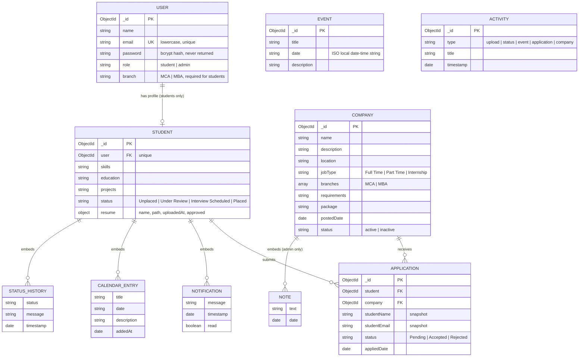

# Database design

MongoDB (via Mongoose). Six collections; the student document embeds the small lists that always travel with it (notifications, personal calendar, status history).

## Entity-relationship diagram

`EVENT` and `ACTIVITY` are standalone collections (events are shared by all students; activities feed the admin dashboard).

## Collections

### `users`
| Field | Type | Notes |
|---|---|---|
| `name` | String | required, trimmed |
| `email` | String | required, **unique**, stored lowercase, basic format check |
| `password` | String | required, min 6 characters, **bcrypt-hashed** before save, `select: false` (never returned by queries) |
| `role` | String | `student` (default) or `admin` |
| `branch` | String | required when `role` is `student` (`MCA` or `MBA`) |
| `createdAt`, `updatedAt` | Date | automatic |

### `students`
| Field | Type | Notes |
|---|---|---|
| `user` | ObjectId → `users` | required, **unique** (one profile per account) |
| `skills`, `education`, `projects` | String | free text from the profile form |
| `status` | String | `Unplaced` (default), `Under Review`, `Interview Scheduled`, `Placed` |
| `resume.name` | String | sanitised original file name (display only) |
| `resume.path` | String | stored file name (random UUID + `.pdf`) — never a public URL |
| `resume.uploadedAt` | Date | |
| `resume.approved` | Boolean | set by the admin; required to apply |
| `notifications[]` | `{ message, timestamp, read }` | created by admin/system actions |
| `events[]` | `{ title, date, description, addedAt }` | the student's personal calendar |
| `statusHistory[]` | `{ status, message, timestamp }` | one entry per real status change |

### `companies`
| Field | Type | Notes |
|---|---|---|
| `name`, `description`, `location` | String | required |
| `jobType` | String | `Full Time`, `Part Time`, `Internship` |
| `branches[]` | String | each must be `MCA` or `MBA`; at least one is required by the API |
| `requirements`, `package` | String | display text (e.g. `8–12 LPA`) |
| `postedDate` | Date | |
| `status` | String | `active` (default) / `inactive` |
| `notes[]` | `{ text, date }` | **admin-only** — never sent to students |

### `applications`
| Field | Type | Notes |
|---|---|---|
| `student` | ObjectId → `students` | required |
| `company` | ObjectId → `companies` | required |
| `studentName`, `studentEmail`, `course`, `skills`, `resumeName` | String | snapshot at the time of applying |
| `status` | String | `Pending` (default), `Accepted`, `Rejected` |
| `appliedDate` | Date | |

**Index:** unique compound `{ student: 1, company: 1 }` — a student can apply to a company only once.

### `events`
`title` (required), `date` (string from a `datetime-local` input, required), `description`.

### `activities`
`type` (`upload`, `status`, `event`, `application`, `company`), `title`, `timestamp`. The admin dashboard shows the latest entries.

## Design notes & trade-offs

- **Embedding vs. referencing** — notifications, calendar entries and status history are embedded because they are always read together with the student and stay small. Applications are a separate collection because admins query them across students and companies.
- **Snapshots in `applications`** (name, email, skills) keep the admin list readable even if the student later edits their profile.
- **Events store their date as a string** (the local date-time chosen by the admin) and are sorted lexicographically, which works for that fixed format. Moving to a real `Date` type with an explicit time zone is a listed improvement.
- **Student calendar entries copy title and date** from the event instead of referencing it, so editing an event does not update students' personal copies.
- **Hard delete of a company** also deletes its applications; the `inactive` status exists for a softer "close" but has no UI yet.
- Notifications are appended on every event change for every student; a capped or separate collection would be needed at larger scale.
