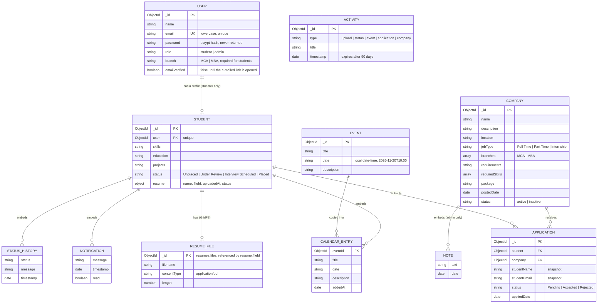

# Database design

MongoDB through Mongoose. There are six collections plus one GridFS bucket for resume files. The student document embeds the small lists that always travel with it (notifications, personal calendar, status timeline).

## Entity-relationship diagram

`EVENT` and `ACTIVITY` are standalone collections: events are shared by all students, activities feed the admin dashboard.

## Collections

### `users`
| Field | Type | Notes |
|---|---|---|
| `name` | String | required, trimmed |
| `email` | String | required, **unique**, stored in lower case, format checked |
| `password` | String | required, 8 to 72 characters, **bcrypt hash** (never stored in plain text), `select: false` so queries do not return it |
| `role` | String | `student` (default) or `admin` |
| `branch` | String | required for students: `MCA` or `MBA` (the list is in `config/constants.js`) |
| `emailVerified` | Boolean | `false` for a new public registration until the e-mailed link is opened; **defaults to `true`**, so accounts created before verification existed and the seeded demo accounts keep working |
| `emailVerificationToken`, `emailVerificationExpires` | String, Date | SHA-256 **hash** of the verification token and its expiry (24 hours); removed once used. `select: false` |
| `passwordResetToken`, `passwordResetExpires` | String, Date | SHA-256 **hash** of the reset token and its expiry (60 minutes); removed once used. `select: false` |
| `passwordChangedAt` | Date | set when the password is reset; login tokens issued before it are rejected |
| `createdAt`, `updatedAt` | Date | automatic |

### `students`
| Field | Type | Notes |
|---|---|---|
| `user` | ObjectId to `users` | required, **unique**: one profile per account |
| `skills`, `education`, `projects` | String | free text from the profile |
| `status` | String | `Unplaced` (default), `Under Review`, `Interview Scheduled`, `Placed` |
| `resume.name` | String | cleaned original file name, for display |
| `resume.fileId` | ObjectId | the file in the `resumes` GridFS bucket |
| `resume.uploadedAt` | Date | |
| `resume.status` | String | `pending` (default), `approved`, `rejected`. Only `approved` allows applying |
| `notifications[]` | `{ message, timestamp, read }` | created by system and admin actions; the newest 100 are kept |
| `events[]` | `{ eventId, title, date, description, addedAt }` | the personal calendar |
| `statusHistory[]` | `{ status, message, timestamp }` | one entry per real status change |

### `companies`
| Field | Type | Notes |
|---|---|---|
| `name`, `description`, `location` | String | required |
| `jobType` | String | `Full Time`, `Part Time` or `Internship` |
| `branches[]` | String | each is `MCA` or `MBA`; the API requires at least one |
| `requirements` | String | text shown to students, at most 500 characters |
| `requiredSkills[]` | String | skills used for matching, at most 20, each up to 40 characters |
| `package` | String | display text such as `8-12 LPA` |
| `postedDate` | Date | |
| `status` | String | `active` (default) or `inactive` (archived) |
| `notes[]` | `{ text, date }` | **admin only**, never sent to students |

### `applications`
| Field | Type | Notes |
|---|---|---|
| `student` | ObjectId to `students` | required |
| `company` | ObjectId to `companies` | required |
| `studentName`, `studentEmail`, `course`, `skills`, `resumeName` | String | copied when the student applies |
| `status` | String | `Pending` (default), `Accepted`, `Rejected` |
| `appliedDate` | Date | |

**Index:** unique `{ student: 1, company: 1 }`, so a student can apply to a company only once.

### `events`
`title` (required, up to 120 characters), `date` (required, a local date-time string that must match `YYYY-MM-DDTHH:mm`), `description` (up to 1000 characters).

### `activities`
`type` (`upload`, `status`, `event`, `application`, `company`), `title`, `timestamp`. The admin dashboard shows the latest ten. A TTL index on `timestamp` deletes entries after 90 days.

### GridFS bucket `resumes`
Resume PDFs are stored in MongoDB itself (`resumes.files` and `resumes.chunks`), not on disk. A student has at most one: uploading a new resume writes the new file, saves its id on the student, then deletes the old file. `seed.js` clears the bucket together with the other collections.

## Design notes and trade-offs

- **Embedding versus referencing.** Notifications, calendar entries and the status timeline are embedded because they are always read with the student and stay small. Applications are a separate collection because admins query them across students and companies.
- **Copies in `applications`** (name, email, skills, resume name) keep the admin list readable and historically accurate even if the student later edits their profile.
- **Calendar entries are copies of events**, linked by `eventId`. Editing an event updates every copy; deleting it removes them; both notify all students.
- **Events keep their date as a string** in a fixed local format, so sorting the strings sorts the events. A real `Date` with an explicit time zone would be the next step if events ever span time zones.
- **Removing a company archives it** (`status: inactive`) rather than deleting it, so applications and the students' history stay intact.
- **Notification growth is capped** at 100 per student. A separate collection would be the answer at a larger scale.
- **Skills are plain text on the student** and are parsed on demand by the matcher; there is no separate skills collection. The dictionary lives in code (`backend/data/skills.js`).
- **Status changes touch several documents without a transaction** (application, student, activity). Transactions need a replica set, which Atlas provides, so adding them is a possible hardening step.
