# User manual

This guide covers the portal from two points of view: the **student** and the **placement cell (admin)**. The screenshots use fictional demo data.

- [Getting an account](#getting-an-account)
- [Student guide](#student-guide)
- [Placement cell guide](#placement-cell-guide)
- [Using the portal on a phone](#using-the-portal-on-a-phone)
- [FAQ](#faq)

---

## Getting an account

**Students** register themselves. **Admins** (placement officers) are created by whoever sets up the system; the seed script creates `admin@pms.com`.

1. Open the home page and choose **Student login**, then **Register** on the red panel.
2. Enter your name, e-mail, a password of at least 6 characters (twice) and your **course** (MCA or MBA).
3. You are taken back to the login form. Log in with the same e-mail and password.

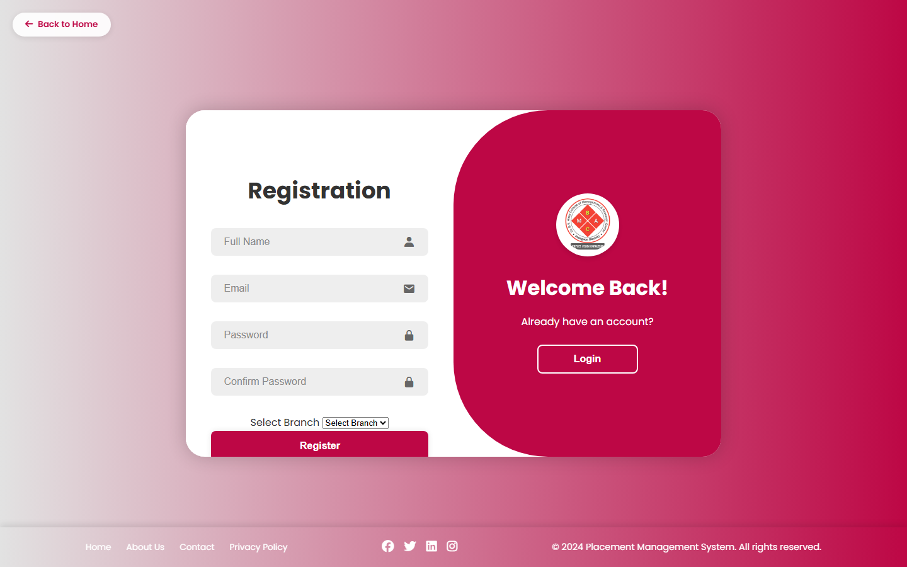

> Your course decides which companies you can see and apply to. It cannot be changed later.

Admins use the **Admin login** button on the home page. It only accepts admin accounts, and the student login only accepts students.

---

## Student guide

After logging in you land on the **Dashboard**. The sidebar leads to every section.

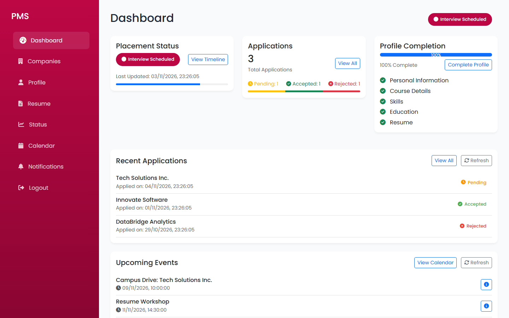

### Dashboard
- **Placement status** shows where you are: *Unplaced*, *Under Review*, *Interview Scheduled* or *Placed*, with a progress bar. **View timeline** opens the history.
- **Applications** counts what you sent and how many are pending, accepted or rejected.
- **Profile completion** is a checklist of what is still missing: skills, education, projects, a resume, an approved resume.
- **Recommended for you** lists open jobs ranked by how many of the required skills you already have (see [Recommendations](#recommendations)).
- **Recent applications** and **Upcoming events** are listed below.

### 1. Complete your profile
Open **Profile** and fill in **Skills** (separated by commas), **Education** and **Projects**, then press **Save profile**. You can change your name; e-mail and course are read-only.

> You need at least one skill on your profile before you can apply to a company.

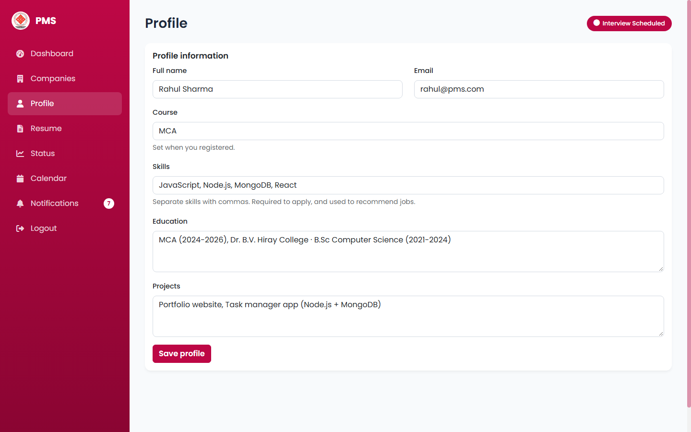

### 2. Upload your resume
Open **Resume**, choose a **PDF** (up to 5 MB) and press **Upload**.

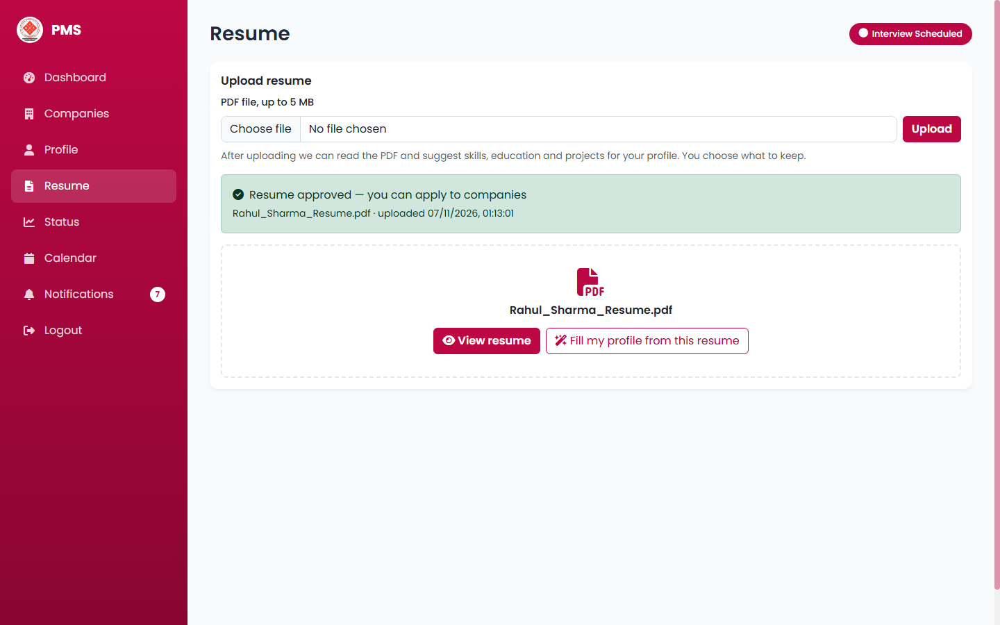

- The resume shows **pending** until the placement cell reviews it. You get a notification when it is approved or rejected.
- **View resume** opens your own file. Uploading a new one replaces the old one and starts the approval again.
- Right after an upload, and any time later with **Fill my profile from this resume**, the portal reads the PDF and shows what it found. Tick what you want, edit the text if needed and press **Add to my profile**. Nothing is saved until you do. Skills you already have are marked.

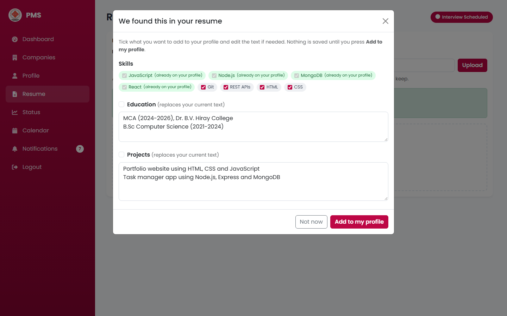

If the PDF is a scan or a photo it contains no text; the portal tells you, and you fill in the profile by hand. A resume exported from Word or Google Docs works best.

### 3. Find and apply to companies
Open **Companies**. You only see companies that are open to your course. Search by name or city, filter by job type, sort by newest or **best match**, press **View details** for the full description and **Apply** to send your application.

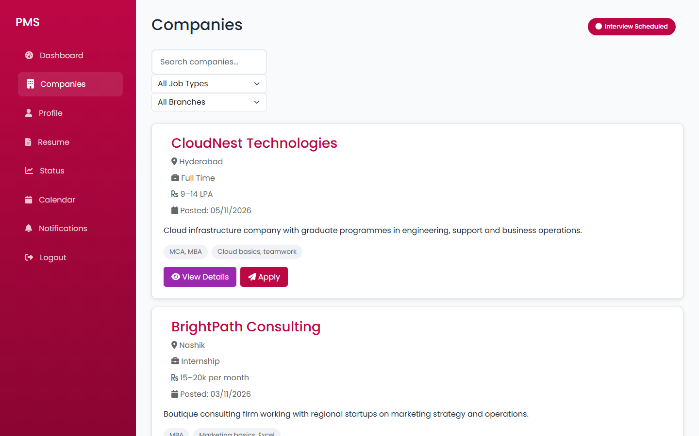

You can apply when **all** of these are true:
- your profile has skills,
- your resume is uploaded **and approved**,
- the company is open to your course and still accepting applications,
- you have not applied to it before.

If something is missing, the portal says exactly what.

### Recommendations
Every job shows a **match** percentage: the share of its required skills that you already have. Green skill chips are skills you have, grey ones are still to learn. Skills come from your profile's Skills field and from known skills named in your projects. Jobs you already applied to are left out of the recommendations, and a job that lists no recognisable skills has no percentage.

### 4. Follow your progress
- **Status** shows a timeline of your placement-status changes.
- **Dashboard, Recent applications** shows each application as *Pending*, *Accepted* or *Rejected*.
- **Notifications** lists every update from the placement cell, newest first. The number on the sidebar item counts unread ones.

### 5. Events and your calendar
Open **Calendar** to see drives, workshops and mock interviews. **Add to my calendar** keeps an event in your personal list, and the **i** button shows its details. If the placement cell changes or cancels an event, your copy follows.

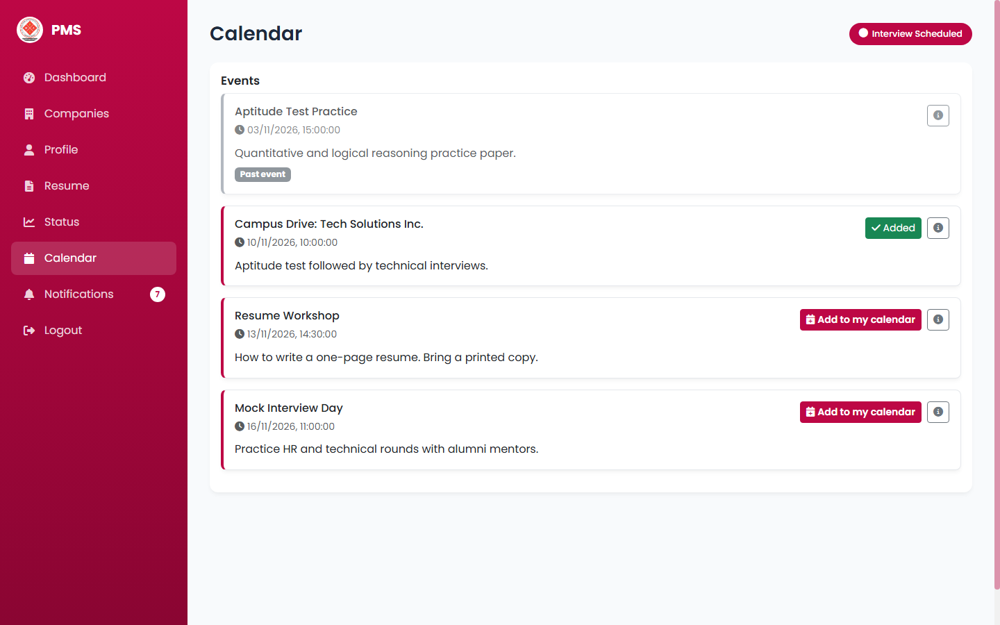

### Logging out
Press **Logout** at the bottom of the sidebar. A login lasts 24 hours; after that you log in again. If you log in or out in one browser tab, your other open tabs reload.

---

## Placement cell guide

### Dashboard
Shows the headline numbers (students, placed, active companies, applications), a **placement-status chart**, the number of students per course, and the **recent activity** feed.

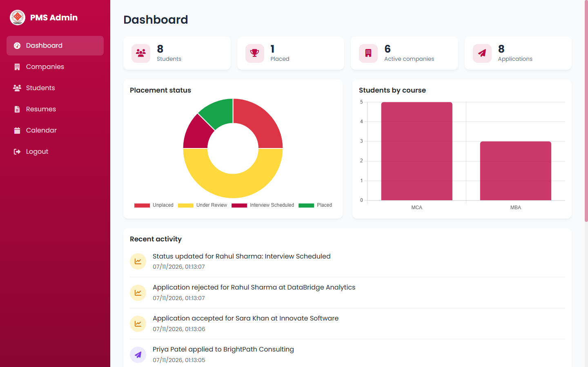

### Companies
Open **Companies** to add, view, edit or remove companies.

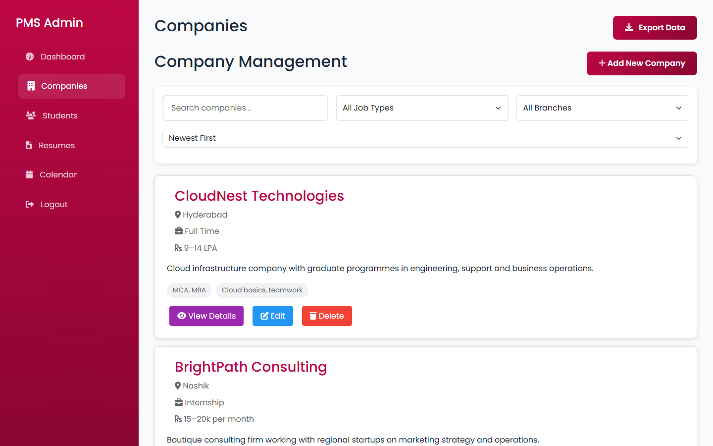

- **Add company** asks for name, description, location, job type, the **courses** it is open to (tick at least one), requirements, package and **required skills** (comma separated). The required skills drive the matching, so enter the real skills of the job.
- **Details** opens the company with application counts, its required skills, the **best-matching students** (match percentage, matching skills and resume status) and **internal notes** that students never see.
- **Edit** loads the company into the same form.
- **Remove** takes the company off the lists. It is archived, not deleted, so the applications already made stay.
- Search, filter by job type or course, and sort by newest, oldest or name.
- The **Applications** list below the companies shows every application. Press **Accept** or **Reject**; the student's placement status and notifications update automatically.

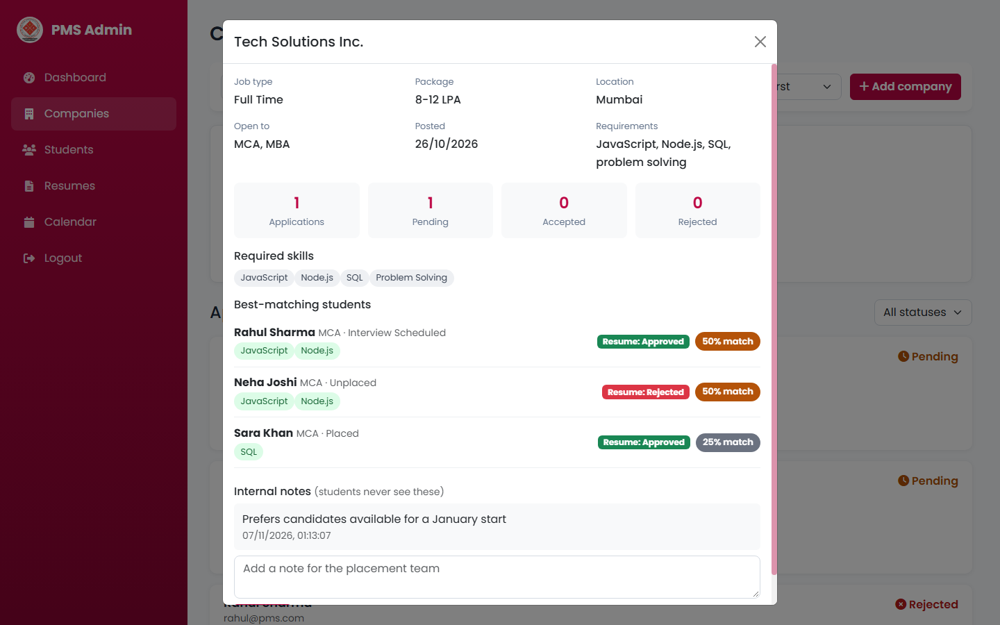

### Students
Open **Students** to search and filter by course or placement status. Use the dropdown on a student's card to set the placement status by hand (for example *Interview Scheduled*); the student is notified. **Profile** shows the skills, education and projects, a button to open the resume, and the placement history. **Export CSV** downloads the list.

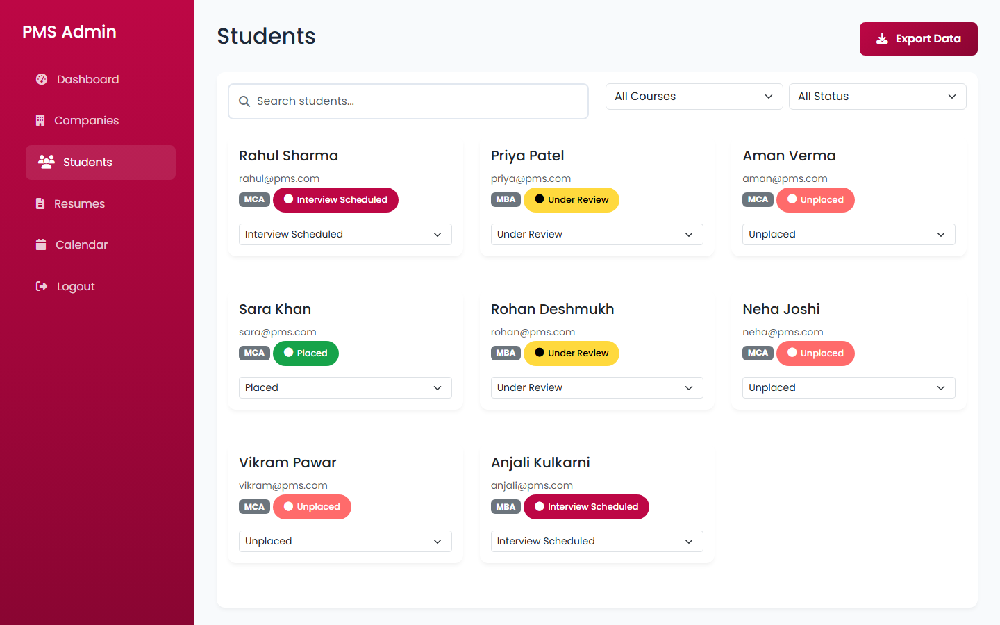

### Resumes
Open **Resumes** to review uploads. The eye button opens the PDF, the tick approves it and the cross rejects it (you are asked to confirm; the student is then asked to upload a new one). Students can apply only after approval.

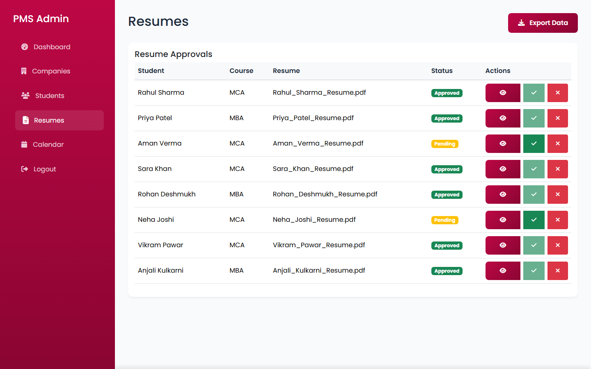

### Calendar
Create events with a title, a date and time and a description. **Every student is notified** when an event is created, changed or cancelled, and the copies in their calendars are updated.

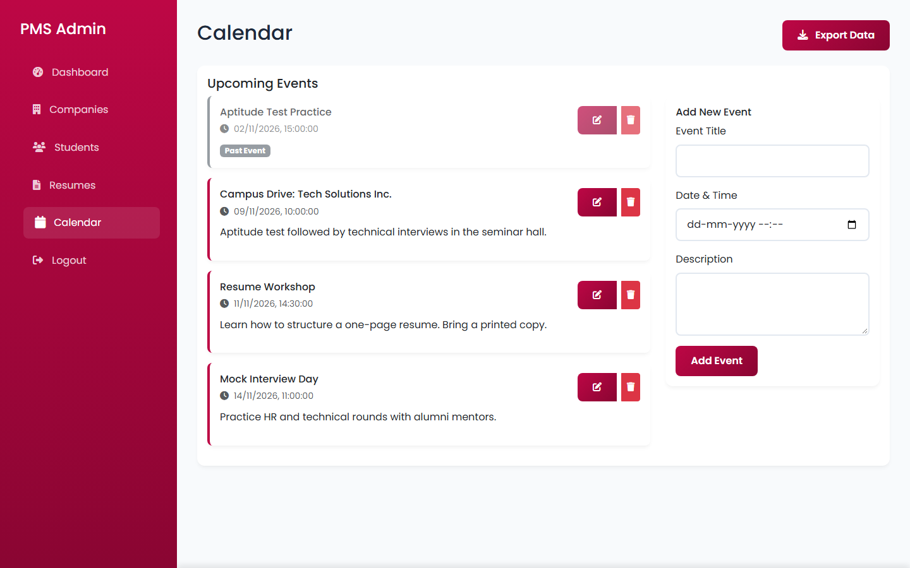

---

## Using the portal on a phone

On screens narrower than 993 px the sidebar becomes a menu. Tap the round menu button in the top bar to open it; tap an item, tap outside the menu or press **Esc** to close it.

  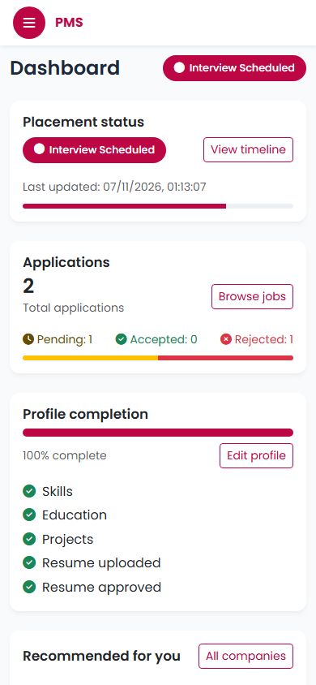
  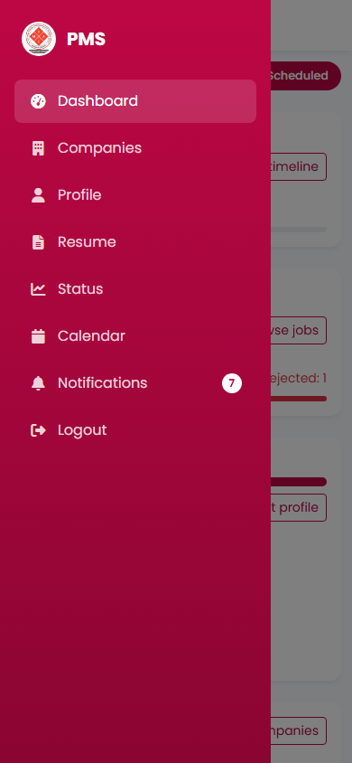
  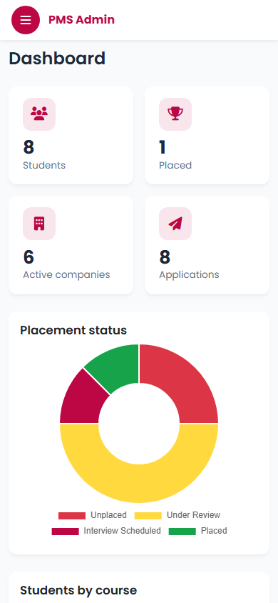

---

## FAQ

**I cannot apply, or I get a message about my resume.** Your resume must be uploaded *and* approved by the placement cell, and your profile needs skills.

**Why do I not see a particular company?** Companies appear only if they are active and open to your course.

**The scan found nothing, or the wrong thing.** The scan looks for known skills and for headings such as *Education* and *Projects*. If your resume uses different headings, copy the text into the profile by hand.

**I forgot my password.** There is no self-service reset yet. Ask the placement cell.

**"Too many failed login attempts."** After 10 wrong passwords from the same network the login pauses for 15 minutes.

**My session ended.** A login lasts 24 hours. After that, or if the server was reconfigured, log in again.
